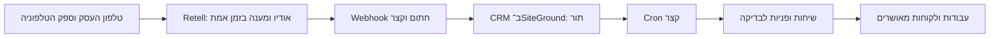

# תשתית שיחות עתידית — Retell AI, כבוי כברירת מחדל

נבחר Retell AI כמתאם הראשון לפלטפורמת Voice AI ייעודית. זו בחירת ארכיטקטורה, לא טענה שהיא האפשרות הטובה ביותר בכל שפה, מחיר או אזור. לפני הפעלה יש לבצע בדיקת איכות לשפה, לשיחות אמיתיות ולספק הטלפוניה המתאים.

**לא הופעלו חשבון, agent, מספר טלפון, שיחות או תמלול בענן.** אין בקוד פעולת חיוג או קריאה יוצאת ל־Retell. כל בדיקות האירועים נעשות עם fixtures מקומיים.

## מה מוכן בקוד

- endpoint: `POST /api/v1/voice/retell`.
- כשהמתאם כבוי: HTTP 503 עם `integration_disabled`, לפני אימות או כתיבת אירוע.
- כשהוא מופעל בעתיד: אימות `X-Retell-Signature` מול גוף הבקשה המקורי, HMAC-SHA256 וחלון זמן של חמש דקות. נבדק מול פורמט SDK הרשמי 6.2.4.
- agent_id חייב להופיע במיפוי פרטי לחברה. תוכן שיחה אינו יכול לבחור חברה.
- קליטת `call_started`, `call_ended`, `call_analyzed` לתור עמיד במסד.
- event_id נגזר מ־call_id וסוג אירוע: ניסיונות חוזרים נמנעים מיצירת כפילויות.
- מצב שיחה אינו חוזר אחורה אם אירועים הגיעו שלא בסדר.
- סיכום ופרטי קשר מקבלים פנייה למסך אישור לאחר call_analyzed. תמליל מלא אינו נשמר כברירת מחדל.
- suggestion לדחיפות נשמר כהמלצה; אישור מנהל קובע את הערך ביצירת ליד.
- אין שיבוץ אוטומטי, שינוי מחיר, שליחה לטכנאי, משיכת מידע חופשית או הנפקת חשבונית מתוך webhook.

## ההפרדה מ־SiteGround

SiteGround מריץ PHP קצר ו־Cron. הוא אינו מארח כאן שרת WebSocket, מודל דיבור או worker שרץ תמיד. כשנידרש שירות כלים בזמן אמת או שיגור כבד, ניתן להוסיף שירות נפרד ב־Cloud Run/שרת ייעודי ולחברו ל־API מוגבל של ה־CRM.

## הפעלה בעתיד — רק אחרי החלטה מפורשת

1. פתח חשבון Retell ובדוק עלויות, שפה, פרטיות, שמירת הקלטות ומדיניות הודעה על הקלטה לפי אזור הפעילות.
2. בנה agent עם זהות MasterLocknKey, מסלול העברה לאדם והגבלות על מחיר וזמן הגעה. בחר מספר עסקי או חיבור טלפוניה מתאים.
3. הגדר שדות ניתוח `full_name`, `phone`, `email`, `address`, `city`, `state`, `zip`, `description`, `priority_hint`. הפרטים אינם אמינים רק כי הגיעו ממודל; יש להקריא כתובת לאישור ולבדוק חריגים.
4. הגדר webhook ל־`https://crm.masterlocknkey.com/api/v1/voice/retell`. בדוק בתיעוד העדכני אם שם שדה או פורמט חתימה השתנה; הקוד מתייחס לפורמט שנבדק.
5. הוסף רק ב־config הפרטי `RETELL_API_KEY`, את המיפוי `RETELL_AGENT_COMPANIES => ['agent_actual_id' => actual_company_id]`, ורק אז `RETELL_ENABLED => true`.
6. בצע שיחת בדיקה בהסכמה, בדוק חתימה, company mapping, ניסיונות חוזרים, Cron ופנייה חדשה. התחל באיסוף פניות בלבד.

השאר `RETELL_STORE_TRANSCRIPT=false` אלא אם יש צורך מוגדר והרשאות ומדיניות שמירה מתאימות. הניקוי היומי מסיר תמלילים שפג תוקפם ותוכן אירועים שעובדו, אך משאיר מזהי deduplication ופניות עסקיות. מדיניות מחיקת פניות וסיכומים צריכה להיקבע בנפרד.

## שליפה ותעדוף — השלב הבא, שטרם הופעל

בעתיד הוסף API כלים נפרד עם token מוגבל לחברה ופעולות מוגדרות: חיפוש לקוח מאומת, פרטי עבודה וכתובת השירות, זמינות ושמירת סיכום. אל תיתן למודל SQL חופשי או גישה למסכי המנהל. אין בקוד הזה endpoint ציבורי לשליפת מידע ל־AI.

כתובת השירות נמצאת ב־`jobs.address/city/state/zip`, ולא בהכרח בכתובת החיוב של הלקוח. זיהוי אדם מתקשר אינו יכול להסתמך רק על caller ID לפני גילוי מידע רגיש.

למנוע התעדוף דרושים אילוצים מפורשים: דחיפות, חלון זמן והתחייבות, זמן המתנה, מרחק, כישורי טכנאי, זמינות, משך משוער וחלקים. `dispatch_priority` נשמר במטא של העבודה אחרי אישור. מנוע מסלולים, יומן זמינות, קביעת ניקוד ושיגור אוטומטי עדיין אינם ממומשים.

המערכת כעת תומכת בכמה מותגים של מפעיל אחד; אין לבסס בידוד של עסקים עצמאיים על מיפוי agent בלבד. לשירות למספר עסקים נדרשת הרחבת בידוד הנתונים והרשאות בכל מסלול.

מקור חתימה: https://github.com/RetellAI/retell-typescript-sdk/blob/main/src/lib/webhook_auth.ts . נבדק גם מול חבילת retell-sdk 6.2.4 מ־npm, לאחר אימות SHA-512 של הארכיון לפי metadata של ה־registry.
