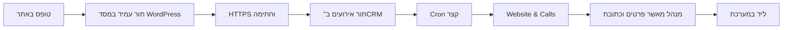

# MasterLocknKey — הכנת האתר וחיבור טופס ל־CRM

ה־CRM אינו אתר WordPress, ואינו מקבל כרגע התחברות מתוך WordPress. הוכנה הפרדה: אתר ציבורי בדומיין הראשי, מערכת ניהול בתת־דומיין, ומסדים ומשתמשי מסד נפרדים. הפניות נשלחות בין השרתים ב־HTTPS עם חתימת HMAC; אין מפתח CRM ב־HTML או ב־JavaScript של האתר.

## מבנה האתר המומלץ

- דף בית עם שם MasterLocknKey, אזור שירות ודרכי קשר אמיתיים.
- עמודי שירות שהעסק אכן מספק: למשל רכב, בית ועסק, לאחר אישור היקף השירות.
- אודות, אזורי שירות ויצירת קשר.
- עמוד מדיניות פרטיות ותנאי שימוש בהתאם לפעילות.
- טופס בקשת שירות, ולחצן חיוג לאחר שיש מספר עסקי.

אין להציג 24/7, זמני הגעה, מחיר, רישיון או ביקורות שלא אושרו. לא נבנה או פורסם אתר מלא בחשבון WordPress; סופקו התוסף, מבנה האתר והוראות החיבור.

## התקנת התוסף

1. התקן WordPress מהחשבון בדומיין `masterlocknkey.com`, עם HTTPS ומנהל בעל סיסמה חזקה. בחר עיצוב נתמך והסר תוספים ודוגמאות שאין בהם צורך.
2. ב־Plugins → Add New → Upload Plugin העלה `masterlocknkey-wordpress-plugin.zip` והפעל אותו.
3. צור עמוד שירות/צור קשר, הוסף בלוק Shortcode וכתוב:

```text
[masterlocknkey_request]
```

4. צור ובחר עמוד פרטיות בהגדרות WordPress; הטופס מקשר אליו ודורש הסכמה ליצירת קשר.

התוסף כולל שם, טלפון, מייל, כתובת שירות ותיאור. שם וטלפון חובה; ניתן להשלים כתובת בהמשך במסך בדיקת הפנייה. הטופס באנגלית בהתאם למערכת הקיימת.

## הגדרה פרטית בשני הצדדים

צור secret אקראי של לפחות 32 תווים, למשל במחשב מהימן:

```bash
php -r 'echo bin2hex(random_bytes(32)), PHP_EOL;'
```

שמור אותו באופן פרטי. אל תעלה אותו לגיט או תשלח בצ׳אט. ב־`crm-private/config/local.php`:

```php
'WEBSITE_ENABLED' => true,
'WEBSITE_KEYS' => [
    'wordpress-main' => ['secret' => 'PASTE_PRIVATE_SECRET_HERE', 'company_id' => 1],
],
```

החלף את company_id במזהה MasterLocknKey שנוצר בהתקנה. אתר אינו רשאי לבחור חברה לפי שדה בטופס: השיוך נקבע רק במיפוי הפרטי ב־CRM.

ב־wp-config.php, לפני סיום ההגדרות וטעינת WordPress:

```php
define('MLK_CRM_ENABLED', true);
define('MLK_CRM_URL', 'https://crm.masterlocknkey.com');
define('MLK_CRM_INTEGRATION_ID', 'wordpress-main');
define('MLK_CRM_SECRET', 'PASTE_THE_SAME_PRIVATE_SECRET_HERE');
```

הסוד בשני הצדדים צריך להתאים. אם משתמשים במנהל סודות בחשבון אפשר לקרוא ממנו באותם קבצים. URL חייב להיות HTTPS; אסור למשתמש בטופס לשנות אותו.

## מסלול הפנייה



ההודעה באתר מאשרת קבלת בקשה, ולא הזמנת טכנאי. אם ה־CRM זמנית לא זמין, הפנייה נשמרת ב־WordPress ונשלחת שוב עם אותו event_id. כך ניסיון חוזר אינו יוצר פנייה נוספת ב־CRM. לאחר מסירה מצליחה, פרטי הפנייה נמחקים מהתור באתר. עד עשרה ניסיונות; כשל סופי דורש טיפול מנהל.

WordPress משתמש ב־WP-Cron, שאינו שעון מובטח באתר עם מעט כניסות. מומלץ להפעיל את Cron של האתר מהשרת לפי אפשרויות SiteGround/WordPress, ולבדוק שהאירוע `mlk_crm_send_queue` אכן רץ. אין לכבות WP-Cron לפני שהוגדר תחליף תקין. ב־Tools → MasterLocknKey CRM אפשר לראות מצב חיבור ומוני תור בלי לחשוף מפתחות או פרטי לקוחות.

הטופס כולל nonce, honeypot וקצב פניות מוגבל לפי IP. אלה הגנות בסיסיות; באתר ציבורי עם ספאם יש להוסיף בקרת bot מתאימה ולבדוק תאימות cache. אין להסתמך על nonce כתחליף לאמצעי anti-bot.

## בדיקת קבלה

שלח פנייה עם פרטי בדיקה. בדוק שמספר הפניות בתור יורד אחרי Cron, והפנייה מופיעה ב־CRM. אשר כתובת, בחר לקוח קיים כדי למנוע כפילויות או צור לקוח חדש, ואשר יצירת ליד. לחץ שוב או שלח שוב אותו אירוע בבדיקת מערכת: צריך להיווצר ליד אחד בלבד.

אם WordPress מציג sent אבל ה־CRM עדיין אינו מציג פנייה, בדוק Cron של CRM. אם מצב pending/failed נשאר באתר, בדוק URL, HTTPS, התאמת secret ו־integration_id, company_id פעיל ו־WAF. אין לבטל אימות TLS כדי לגרום לחיבור לעבוד.
